footprint_attributes
=====================

.. raw:: html

   

   <section class="fa-hero">
     

       
footprint_attributes · v1.1.0

       
Plan irregularity and block position from building footprints

       
Building direction, position within the urban block and the
       plan-irregularity parameters of EC8, ASCE 7, GNDT-II, CSCR 2010 and NTC-23,
       computed from building footprint polygons.

       

         <a class="fa-btn fa-btn--solid" href="installation.html">Get started</a>
         <a class="fa-btn" href="examples.html#interactive-map">Interactive map</a>
         <a class="fa-btn" href="citation.html">Cite the paper</a>
       

     

     <figure class="fa-figure">
       <svg class="fa-block" viewBox="0 0 420 300" role="img" aria-label="Urban block with buildings colored by block position class">
         <g stroke="#262626" stroke-width="1" stroke-linejoin="round">
           <polygon fill="#E4E4E4" points="14,36 74,36 74,86 14,86"/>
           <polygon fill="#E4E4E4" points="352,206 402,206 402,256 352,256"/>
           <polygon fill="#BCA9D8" points="100,40 190,40 190,90 150,90 150,120 100,120"/>
           <polygon fill="#A8CBE6" points="190,40 260,40 260,120 190,120"/>
           <polygon fill="#7DBBAE" points="260,40 340,40 340,120 260,120"/>
           <polygon fill="#DE95A3" points="100,120 160,120 160,200 100,200"/>
           <polygon fill="#7DBBAE" points="160,120 260,120 260,200 160,200"/>
           <polygon fill="#A8CBE6" points="260,120 340,120 340,160 260,160"/>
           <polygon fill="#BCA9D8" points="260,160 340,160 340,200 260,200"/>
         </g>
         <path d="M100 216 H340" stroke="#1F4E79" stroke-width="2"/>
         <path d="M100 211 V221 M340 211 V221" stroke="#1F4E79" stroke-width="2"/>
         <text x="220" y="240" text-anchor="middle" font-size="13" fill="#1F4E79" font-family="Inter, sans-serif">footprints in, attributes out</text>
       </svg>
       <figcaption>
         Isolated
         Lateral
         Corner
         Confined
         Torque
       </figcaption>
     </figure>
   </section>

   <section class="fa-section">
     <h2>What it computes</h2>
     <ol class="fa-index">
       <li><a href="concepts.html">01Block positionHow a building is attached to its neighbours<code>position()</code></a></li>
       <li><a href="concepts.html">02DirectionPrincipal axes and bearing of each footprint<code>direction.inertia()</code></a></li>
       <li><a href="formulas.html">03Plan dimensionsThe lengths setback and slenderness are built from<code>L1 L2 a1 a2 b c</code></a></li>
       <li><a href="formulas.html">04Shape indices15 irregularity parameters from EC8, ASCE 7, GNDT-II, CSCR 2010, NTC-23<code>shape.EC8()</code></a></li>
       <li><a href="api/run.html">05All at onceOne call, any set of columns<code>run()</code></a></li>
     </ol>
   </section>

**Seismic behaviour modifiers from 2-D building footprints, automated,
objective and reproducible.**

``footprint_attributes`` turns a file of building footprint polygons into
the attributes seismic risk models need for every building. These are its
direction, its position within the urban block, and its plan-shape
irregularity under five international seismic codes. Each is computed with
a deterministic geometric algorithm instead of expert judgement. It is the
companion package to:

    Ureña-Pliego, M., Rodríguez-Saiz, J., Núñez-Álvarez, G.,
    Marchamalo-Sacristán, M., González-Rodrigo, B. (2026). *A methodology
    for the automated estimation of footprint-derived seismic behaviour
    modifiers in building exposure assessment.* Advanced Modeling and
    Simulation in Engineering Sciences, 13:3.
    `doi.org/10.1186/s40323-026-00323-y
    <https://link.springer.com/content/pdf/10.1186/s40323-026-00323-y.pdf>`_

Developed by the `Advanced Geomatics group (AGA)
<https://blogs.upm.es/aga/en/>`_ at the Universidad Politécnica de Madrid
(see :doc:`citation`). Source code:
`github.com/GeomaticsCaminosUPM/footprint_attributes
<https://github.com/GeomaticsCaminosUPM/footprint_attributes>`_.

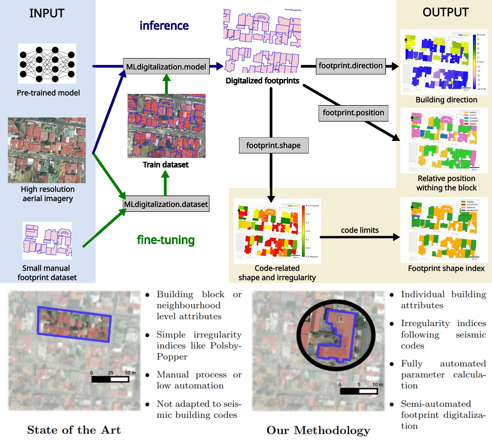

Why?
----

Seismic risk models adjust each structural typology's vulnerability with
*behaviour modifiers*. Several of them (the ones boxed in red in the GEM
building taxonomy below) can be derived from the footprint alone, but are
usually assigned by hand by surveyors reading code provisions. This package
turns those provisions into geometric algorithms, so the same footprint
always gets the same answer and a national inventory takes minutes instead
of field campaigns.

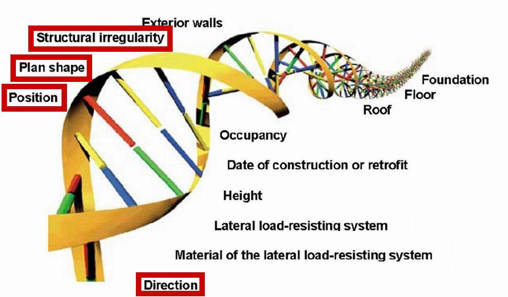

What it computes
----------------

Every value on this page is computed by this package from nothing but the
raw footprint geometry of three pilot regions: Guatemala City (Zona 10),
San José (Mata Redonda) and Santo Domingo (Ensanche Quisquella).

**1 · Block position within the block** --
:mod:`~footprint_attributes.position`. A contact-force analogy classifies
each building as isolated, lateral, corner, confined or torque:

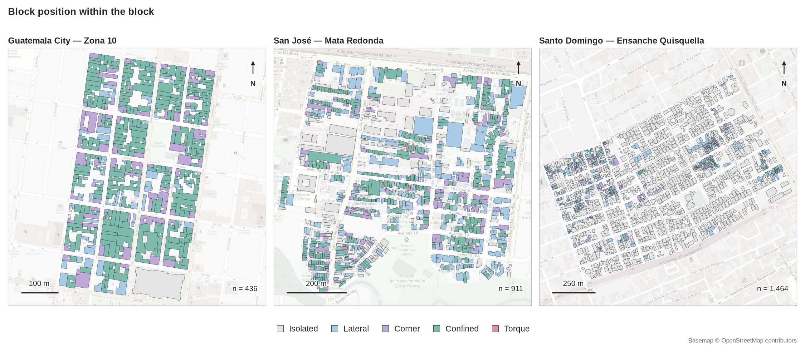

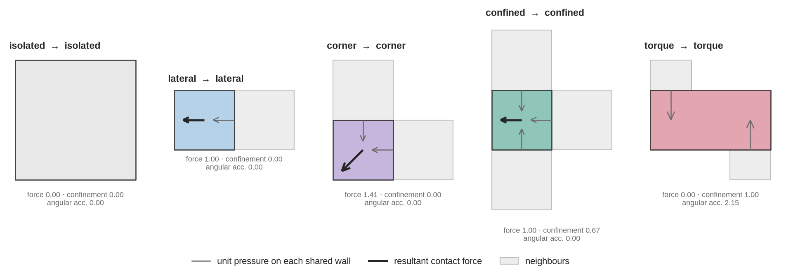

   One hand-built scenario per class, with the contact force on each shared
   wall and its resultant.

**2 · Building direction**: :mod:`~footprint_attributes.direction`.
Each footprint's principal axes come from its minimum bounding box or its
second moment of area, and its bearing is the heading of the short axis:

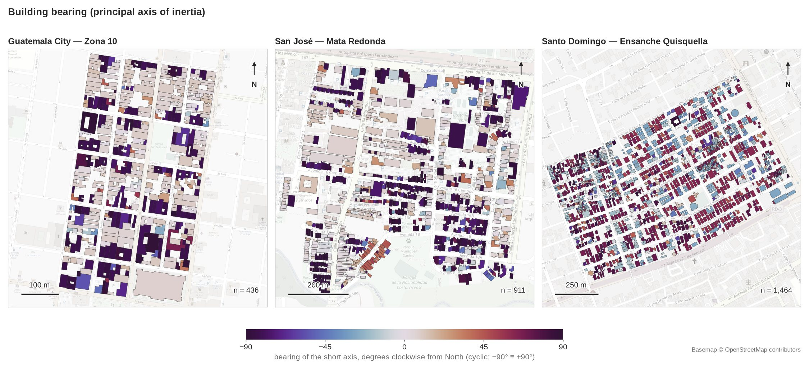

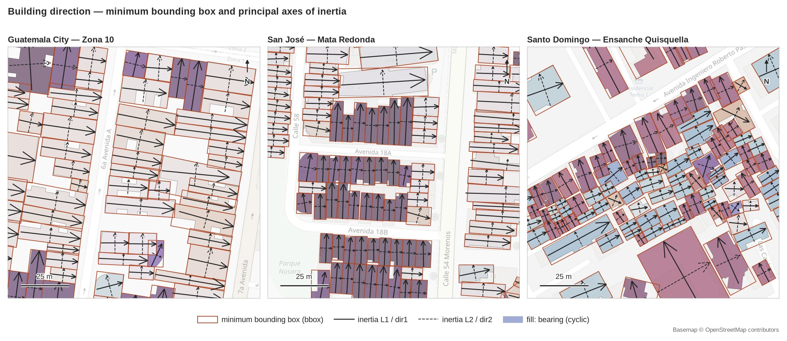

**3 · Basic plan dimensions**: the :math:`L_1, L_2, a_1, a_2, b, c`
lengths that the setback and slenderness parameters are built from:

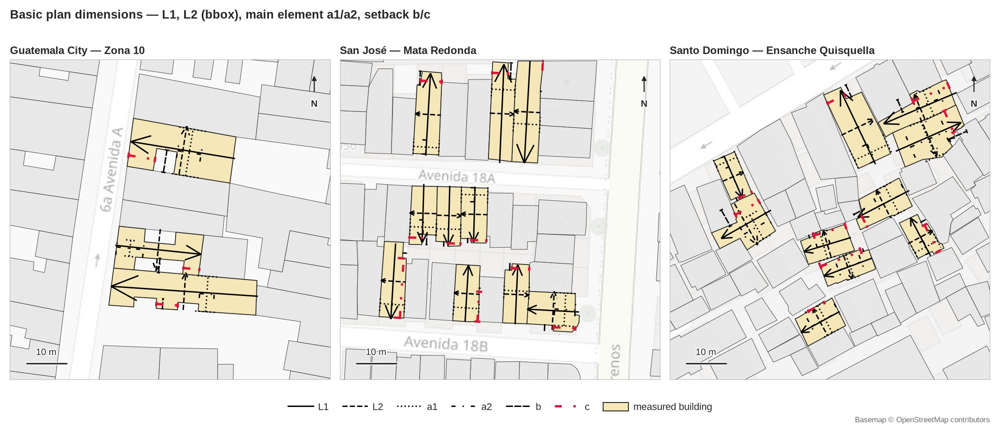

**4 · Footprint shape indices**: :mod:`~footprint_attributes.shape`.
The package computes 15 plan-irregularity parameters from EC8, ASCE 7,
GNDT-II, CSCR 2010 and NTC-23, plus three code-independent compactness
indices. Three of the code checks are condensed into a single shape index:

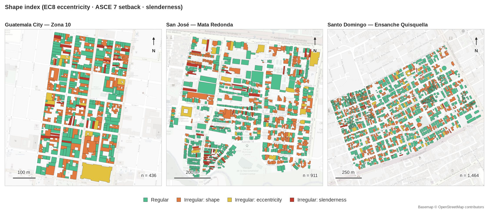

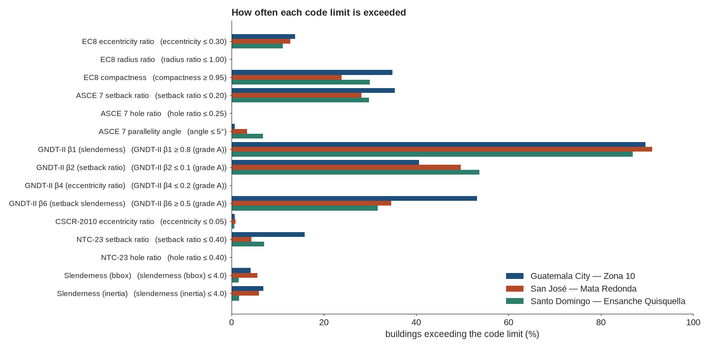

   How often each code limit is exceeded in each pilot region.

See :doc:`concepts` for the full visual walkthrough of each attribute and
:doc:`formulas` for the exact formula, source code and pilot-region map
behind every column.

Quick start
-----------

.. code-block:: bash

   pip install "footprint-attributes @ git+https://github.com/GeomaticsCaminosUPM/footprint_attributes.git@v1.1.0"

.. code-block:: python

   import geopandas as gpd
   import footprint_attributes

   footprints = gpd.read_file("footprints.gpkg")
   result = footprint_attributes.run(
       footprints,
       config={"columns": ["position", "bearing", "EC8", "ASCE7_setbackRatio"]},
   )

See :doc:`installation` and :doc:`api/index` for more.

Interactive map
---------------

The same attributes for every building in one client-side 3D map. It opens
in an auto-playing tour (block position, the shape index, then each of
the 15 shape metrics) with the camera orbiting. Drag, zoom or click to
take over; tick the overlays to draw the convex hull, bounding box, inertia
axis, basic lengths or contact-force arrows on the buildings (see
:doc:`examples` for details):

.. raw:: html

   <iframe src="_static/maps/index.html" width="100%" height="640" style="border:1px solid #111;" loading="lazy"></iframe>

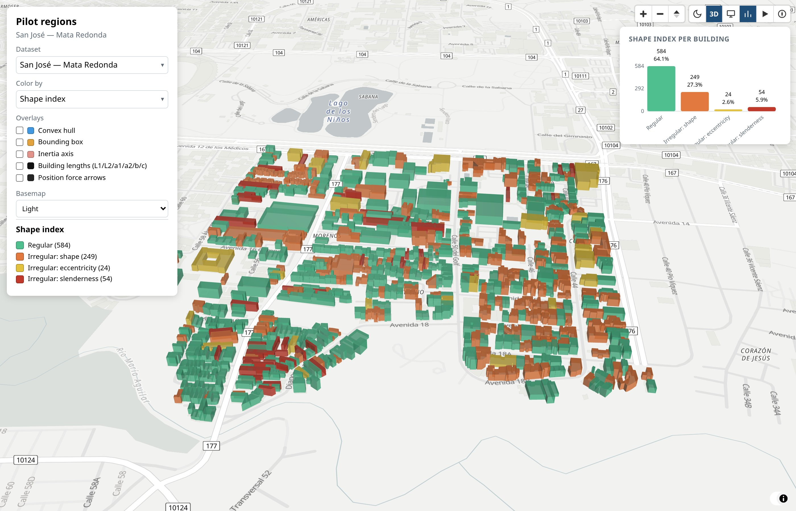
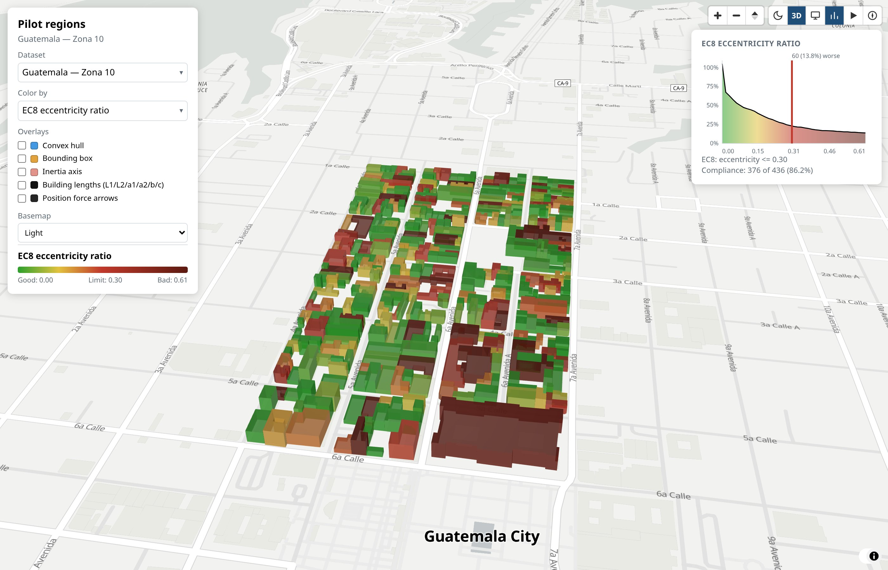
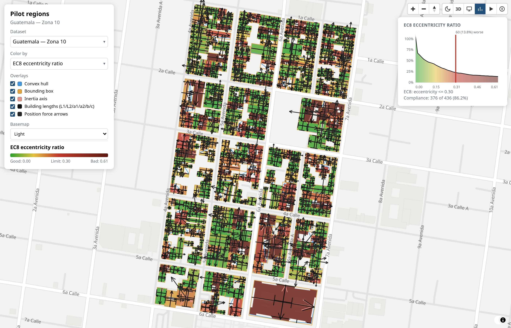

*Left to right: the shape index, a norm-based metric with its exceedance
chart, and all five geometry overlays enabled.*

.. toctree::
   :maxdepth: 2
   :caption: Contents

   installation
   concepts
   api/index
   formulas
   examples
   citation
   license

Indices
-------

* :ref:`genindex`
* :ref:`modindex`
